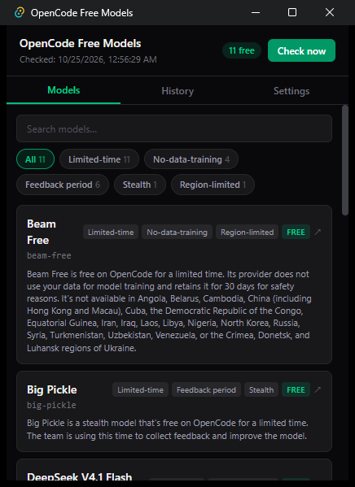
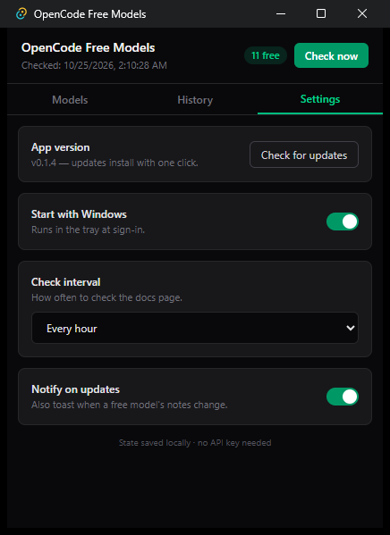

# OpenCode Free Models Watcher

**Never miss a free AI model release on OpenCode.**

OpenCode Free Models Watcher is a lightweight Windows system tray app that monitors OpenCode's free AI model catalog in the background and notifies you when models are added, removed, or updated.

Some free models are only available for a limited time. Instead of repeatedly checking the models page yourself, this app keeps an eye on changes and lets you know when something new becomes available.

## Screenshots

| Models | Settings |
|---|---|
|  |  |

## Features

- **Automatic model monitoring** — Checks OpenCode's official free models page periodically in the background, with a configurable interval.
- **Native Windows notifications** — Get notified when a free model is added, removed, or its details change.
- **Browse free models** — Open a compact system tray widget to search and explore the current free model list, including notes from the official documentation.
- **One-click self-updates** — Releases are signed, and the app updates itself from Settings with an **Update & restart** button. No re-downloading installers.
- **Change history** — Review previously detected model changes.
- **Runs in the background** — Access the app from the Windows system tray instead of keeping a full window open.
- **Launch on startup** — Configure the app to start automatically when Windows starts.
- **Direct access to OpenCode** — Open the official models page directly from the app.
- **Local state and history** — Keeps a local snapshot to detect changes between checks.

No OpenCode account, API key, or separate backend is required.

## Download & Install

1. Open [GitHub Releases](https://github.com/Aymen-khlil/opencode-free-watcher/releases).
2. Download the Windows installer from the newest release: `opencode-free-watcher_<version>_x64-setup.exe`.
3. Run the installer.
4. Find OpenCode Free Models Watcher in your Windows system tray and open the widget.

> **Windows SmartScreen:** the installer is not Authenticode-signed yet, so Windows may show *"Windows protected your PC"*. Click **More info → Run anyway** to continue.

On the first launch, the app saves a baseline of the currently available free models. It then compares future checks against that baseline and notifies you when it detects changes.

**Tip:** Keep the app running in the background so it can check for new models and notify you.

## App Updates

Version **0.1.2 and newer** update themselves: open Settings, click **Check for updates**, and if a new release exists an **Update & restart** button appears. Updates are signed with minisign and verified against the public key bundled in the app, so a tampered download is rejected.

Versions 0.1.0 and 0.1.1 predate the updater and require this **one** manual install before self-updates take over.

## How It Works

1. **Fetch** — The app retrieves the official [OpenCode free models documentation](https://opencode.ai/v2/docs/console/models).
2. **Parse** — It extracts the free models from the pricing table and their associated documentation notes.
3. **Compare** — The current results are compared with a locally saved snapshot.
4. **Notify** — When a meaningful change is detected, the app sends a native Windows notification.
5. **Record** — The local state and change history are updated.

The app identifies free models using their input and output pricing, rather than relying only on model names or a `-free` suffix. This helps it detect models that are free but don't follow a particular naming convention.

### Reliable Change Detection

If OpenCode's models page is temporarily unavailable, the app preserves the last successful snapshot. A failed request is not treated as an empty model list, helping prevent false notifications that every model has been removed.

## Built With

- [Tauri 2](https://tauri.app/) — Lightweight desktop application framework
- [React](https://react.dev/) — User interface
- [TypeScript](https://www.typescriptlang.org/) — Type-safe application code
- [Tailwind CSS](https://tailwindcss.com/) — UI styling
- Rust — Background monitoring, model parsing, change detection, and local state management
- Tauri Notification Plugin — Native desktop notifications
- Tauri Autostart Plugin — Optional startup integration
- Tauri Updater & Process Plugins — Signed in-app updates and relaunch

The app uses Tauri instead of Electron to keep the desktop application lightweight.

## Run From Source

### Prerequisites

- Windows
- Node.js (LTS)
- Rust (stable MSVC toolchain)
- Microsoft C++ Build Tools with the C++ workload
- WebView2

### Setup

Clone the repository:

```bash
git clone https://github.com/Aymen-khlil/opencode-free-watcher.git
cd opencode-free-watcher
```

Install dependencies:

```bash
npm install
```

Run the application in development mode:

```bash
npm run tauri dev
```

Build the Windows installer:

```bash
npm run tauri build
```

The NSIS installer is generated under:

```text
src-tauri/target/release/bundle/nsis/
```

> **Note for local builds:** `bundle.createUpdaterArtifacts` is enabled, so `npm run tauri build` expects an updater signing key. Either provide `TAURI_SIGNING_PRIVATE_KEY` (path or content) and `TAURI_SIGNING_PRIVATE_KEY_PASSWORD`, or set `createUpdaterArtifacts` to `false` in `src-tauri/tauri.conf.json` for a plain local build.

## Project Structure

```text
opencode-free-watcher/
├── .github/
│   └── workflows/       # GitHub Actions release automation
├── docs/
│   └── screenshots/     # README screenshots
├── public/              # Static assets
├── src/
│   └── App.tsx          # Widget UI: Models, History, Settings
├── src-tauri/
│   ├── src/
│   │   ├── lib.rs       # Tray, monitoring timer, notifications, commands
│   │   ├── monitor.rs   # Fetching, parsing, and change detection
│   │   └── store.rs     # Local snapshot and history persistence
│   └── tauri.conf.json  # Window, bundle, updater endpoint and public key
├── latest.json          # Updater manifest for the current release
├── package.json
└── README.md
```

## Data & Privacy

- Model snapshots and change history are stored locally on your Windows machine.
- The app fetches model information from OpenCode's public documentation.
- No OpenCode API key or separate backend service is required.
- No telemetry or analytics of any kind.

Local application state is stored under:

```text
%APPDATA%\com.ceazi.opencode-free-watcher\state.json
```

## Releases & Updates

Prebuilt Windows installers are available on the [Releases page](https://github.com/Aymen-khlil/opencode-free-watcher/releases).

Releases are built by GitHub Actions. Each release publishes the installer, its minisign signature, and a `latest.json` updater manifest; the app polls that manifest through `https://github.com/Aymen-khlil/opencode-free-watcher/releases/latest/download/latest.json`.

For maintainers, shipping a release is:

1. Bump the version in `package.json`, `src-tauri/Cargo.toml`, and `src-tauri/tauri.conf.json`.
2. Commit and push to `main`.
3. Push a matching tag (`git tag vX.Y.Z && git push origin vX.Y.Z`).

CI signs, builds, and publishes everything automatically.

## License

This project is licensed under the [MIT License](LICENSE).
